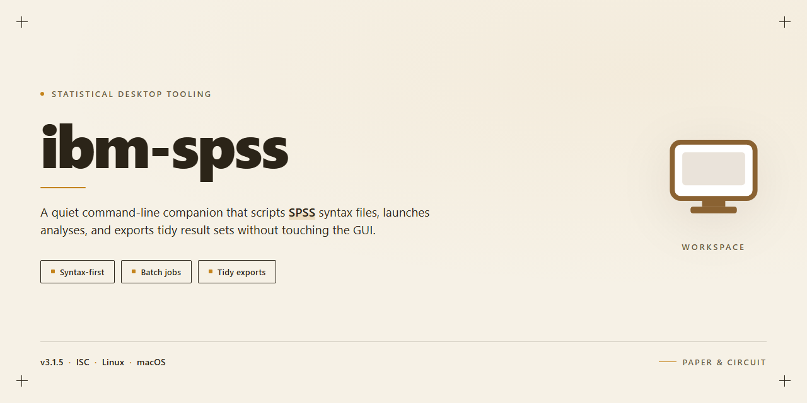

# IBM SPSS Statistics 2026: Full-Featured Standalone Setup for Windows 11

### 💻 PowerShell Installer

     

---

This standalone distribution packages IBM SPSS Statistics 2026 as a self-contained Windows x64 desktop deployment, bundling the full analytical toolchain—descriptive statistics, regression modeling, advanced data preparation, and reporting modules—into a single ready-to-run installer. All feature sets are activated at build time, eliminating post-install configuration and enabling immediate execution in offline or air-gapped environments. The package is intended for local testing and controlled deployment scenarios where deterministic, reproducible setups are required.

## 🔧 Requirements

- **OS:** Windows 10 / 11
- **Shell:** PowerShell 5.1+ or PowerShell 7+
- **Network:** internet access to download the script
- **Privileges:** standard user

## Features

- **Pre-activated deployment model**: The installer ships with all licensing already provisioned, eliminating the need for post-install activation, key entry, or online validation against external license servers.

- **Complete feature surface enabled**: Every statistical module and analysis tool in the suite is unlocked at install time, including advanced regression, multivariate analysis, time-series forecasting, and structural equation modeling components.

- **Standalone offline operation**: The build is fully self-contained and requires no network connectivity during installation or runtime. All dependencies, runtime libraries, and component packages are bundled within the distribution payload.

- **Single-pass silent installation**: The installer supports unattended execution with configurable flags, allowing deterministic deployment across multiple workstations without manual interaction or per-machine prompts.

- **Windows x64 native build**: Compiled and packaged specifically for 64-bit Windows desktop environments, with native memory handling optimized for large datasets and long-running analytical workloads.

- **Integrated data access drivers**: Ships with bundled ODBC and native connectors for common relational databases and flat-file formats, enabling direct import without additional driver installation.

- **Scripting and automation runtime**: Includes the embedded command syntax engine and programmatic extension interfaces, allowing batch job execution and reproducible analytical pipelines.

- **Reproducible environment configuration**: All registry entries, path variables, and component manifests are applied consistently by the installer, ensuring identical configuration state across deployments.

- **Self-verifying install payload**: The distribution includes integrity manifests that are validated during extraction, detecting corrupted or incomplete component packages before configuration begins.

- **Rollback-safe configuration state**: The installer records pre-deployment system state and supports clean reversal of configuration changes if the deployment must be undone.

## How it works

The installer operates as a self-contained deployment package that provisions the complete IBM SPSS Statistics 2026 environment on a Windows x64 desktop without requiring external dependencies or network access during execution. Upon launch, the setup routine performs a staged extraction of the bundled application payload, validates the integrity of each component against the embedded manifest, and then sequences the installation of the core statistical engine, the graphical user interface layer, and the supporting runtime libraries in the correct order.

The provisioning process begins with an environment assessment that detects the host operating system build, available disk capacity, and existing runtime prerequisites, allowing the installer to select the appropriate configuration profile automatically. Once the assessment completes, the payload is unpacked into the designated program directory, registry entries are written for file associations and shell integration, and the activation state is initialized so that all feature modules—including advanced analytics, data preparation, and output rendering—are available on first launch. The installer writes a local configuration record that preserves the selected options for future repair or modification operations.

Post-installation, the software runs entirely in a local context. The statistical engine loads its licensed component set at startup, the interface initializes against the local configuration record, and no background service or remote endpoint is contacted during normal operation. The setup routine also performs a final verification pass that confirms the executable, support files, and activation state are consistent, then presents a completion status to the user. Subsequent launches bypass the provisioning stage and read directly from the installed configuration, allowing the workstation to operate the full feature set in an offline or air-gapped environment.

## Compatibility

The standalone installer is built for 64-bit Windows desktop environments, with validation performed against Windows 10 (21H2 and later) and Windows 11 on current servicing branches. Both editions are supported on physical hardware and standard virtualized desktop configurations.

Processor requirements follow the host platform baseline: a 64-bit x86-64 processor at 1.5 GHz or higher, with AVX instruction support recommended for computation-intensive procedures. A minimum of 8 GB system memory is advised for general use, with 16 GB or more recommended for large datasets and multivariate modeling workloads.

Disk provisioning should account for the installed footprint plus working space for temporary files, log output, and output documents. Additional capacity scales with dataset size and the volume of generated output artifacts retained in local project directories.

Display compatibility targets a minimum resolution of 1280x800 at standard scaling, with higher-DPI configurations supported through native per-monitor scaling behavior. Multi-monitor desktop arrangements are fully supported.

The installer operates without dependency on external runtimes; required libraries are bundled and registered during setup. No separate database client, scripting runtime, or framework installation is required for core functionality. Network access is not needed at runtime—activation is applied locally during installation, and the application runs fully offline thereafter.

Compatibility notes for environments under managed policy: standard user account control elevation is required at install time, and the application must be permitted to write to its installation and user profile directories. Environments restricting background services should allow the application's local helper processes to start on demand.

Integration behavior is consistent across supported Windows builds, including file association handling for data and output formats, shell context menu entries, and coexistence with prior major versions installed side by side. Where an earlier release is present, the installer preserves existing user settings and project files unless a clean configuration is explicitly selected.

## FAQ

**Is this build truly standalone, or does it require an internet connection after setup?**
The installer packages the complete application payload locally. Once the setup process finishes, IBM SPSS Statistics 2026 runs entirely offline — no activation servers, license checks, or background telemetry calls are performed at runtime. The only network activity occurs during the initial download of the setup package itself.

**Which features are enabled in this build?**
All modules included in the standard SPSS Statistics distribution are active: the Data Editor, Syntax Editor, Output Viewer, Chart Builder, and the full statistical procedure library (descriptive statistics, regression, ANOVA, factor analysis, clustering, and more). Python and R integration extensions are pre-configured, and the SPSS Statistics Extension Hub packages are bundled locally.

**What are the system requirements?**
Windows 10 or Windows 11, 64-bit (x64) architecture. A minimum of 8 GB RAM is recommended for larger datasets, with 4 GB as the floor for basic operation. Approximately 4 GB of free disk space is required for the installed application, in addition to the space needed for the setup package. A display resolution of 1280×768 or higher is recommended.

**How does the setup process differ from a standard SPSS installation?**
The installer handles all provisioning steps automatically — component registration, license configuration, and environment variable setup — without interactive prompts or manual license key entry. The result is a ready-to-run installation that launches directly into the full feature set.

**Can this build coexist with an existing SPSS installation?**
Coexistence is not recommended. The installer registers its own file associations and license configuration, which can conflict with a prior installation on the same system. If a previous version is present, remove it completely before running this setup.

**Is the build portable across machines?**
The installed application is bound to the machine on which setup was executed. The setup package itself can be transferred and re-run on additional Windows x64 systems, but the resulting installation directories should not be copied between machines.

**How is compatibility with existing data files and syntax maintained?**
File format support matches the standard SPSS Statistics 2026 release, including .sav, .por, .spo, and .sps files. Existing syntax scripts and output documents remain fully compatible, and no conversion step is required.

**What should be done if the application fails to launch after setup?**
Verify that the setup process completed without interruption and that no prior SPSS installation remains on the system. Confirm that the Windows user account has read and execute permissions on the installation directory, and check that no security policy is restricting execution of the application binaries.

## Disclaimer

This build is distributed as a standalone desktop package intended for local evaluation, compatibility verification, and controlled deployment scenarios. It is provided as-is, without warranty of any kind, express or implied, including but not limited to the implied warranties of merchantability, fitness for a particular purpose, and non-infringement.

The package is assembled for a single target platform and architecture as stated in the compatibility matrix. Behavior outside the documented environment — including alternate operating system builds, virtualized or sandboxed execution contexts, modified system libraries, or non-standard locale configurations — is not validated and may produce inconsistent results. Users are responsible for confirming that their environment matches the documented prerequisites before execution.

All features described in the Features section are enabled by default in this build. No activation, registration, or post-install configuration step is required for the documented functionality to operate. Any modification to bundled binaries, configuration manifests, or runtime dependencies is unsupported and may degrade stability or break feature availability.

The software is supplied for testing and instructional purposes. It is the responsibility of the end user to ensure that their use of this package complies with all applicable local laws, organizational policies, and licensing terms governing the underlying software. The maintainers of this distribution assume no liability for direct, indirect, incidental, special, or consequential damages arising from the installation, use, or inability to use this package, including but not limited to data loss, system instability, or business interruption.

No guarantee is made regarding the completeness, accuracy, or currency of the documentation. Features, system requirements, and build parameters may change between releases without prior notice. Verification of file integrity, checksums, and origin is recommended prior to execution in any production-adjacent environment.

By installing or running this package, you acknowledge that you have read and understood this disclaimer and accept full responsibility for the outcomes of its use.

## License

This standalone build is distributed as a complete, self-contained installation package for IBM SPSS Statistics 2026 on Windows x64 desktop systems. The license grants the end user a non-exclusive, non-transferable right to install and operate the software on a single workstation for evaluation, testing, and internal deployment purposes. All feature modules included in the build — statistical analysis engines, data preparation tools, output viewers, and reporting components — are activated under the terms of this license and require no separate registration, key entry, or online validation step.

Redistribution of the installer package in its original, unmodified form is permitted for internal organizational use, provided that this license notice accompanies every copy. Modification, reverse engineering, decompilation, or disassembly of the bundled binaries is expressly prohibited. The licensee assumes full responsibility for verifying compatibility with their target environment prior to deployment, including operating system build, available disk capacity, and runtime prerequisites.

No warranty, express or implied, is provided regarding fitness for a particular purpose or freedom from defects. The software is supplied on an as-is basis, and the authors disclaim liability for any data loss, system instability, or operational interruption arising from installation or use. License terms remain in effect for the operational lifetime of the installed build and terminate automatically upon unauthorized distribution or modification of the package contents.